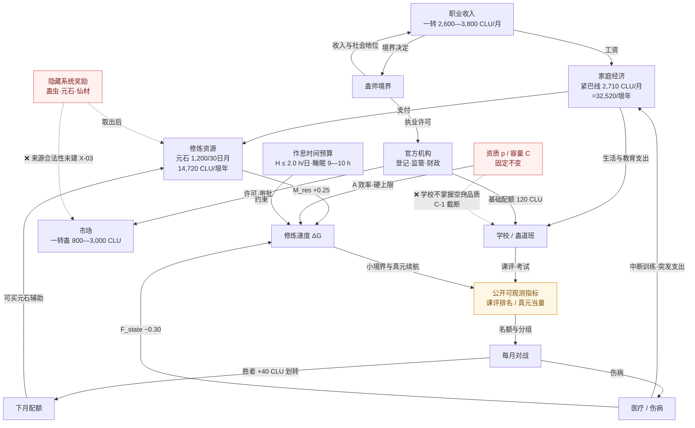

# 99-1 · 衡垠世界运行关系图

> 版本：**v0.2（2026-11-14 定向复核）**｜初版 v0.1（第 1 批，10 条链路）｜日期：2026-11-14｜[总索引](../00_研究总索引.md)
> **v0.2 变更**：快检表扩为 20 项并修正 368 日换算；纠正 E-02（历法口径的正式库出处）；补 D-13／D-14 边界。**未修改任何正式设定。**
> 目的：把 `02`／`03`／`05` 三份研究与正式库制度连成一张可追的资源流图，让 GM 判断「谁管、钱从哪来、谁得利、谁付代价」。
> 图的实线＝已确定或本批提案的直接连接；虚线＝受正式设定截断、需绕道的连接；红色节点＝**待决策或信息边界**。

---

## 一、关系图



> 读法：从「家庭经济」出发一圈会回到「家庭经济」——这就是本世界对主角最紧的闭环：**钱 → 资源 → 修炼速度 → 成绩／对战 → 配额 → 钱（的替代物）**。赢一次比赛划转 40 CLU，只够买 1 天元石辅助，闭环对主角是负向约束，不是翻身通道。

---

## 二、10 条链路 · 七要素

| # | 链路 | 谁管理 | 资源从哪来 | 如何执行 | 谁受益 | 谁付代价 | 可能的问题 | 与其他制度的联动 |
|---|---|---|---|---|---|---|---|---|
| ① | **资质 → 学校培养** | 教务／班主任 | 无（信息本应流动，但被截断） | `04_世界/05:836` 规定学校只知是否开窍成功、不知空窍品质；故差异化培养只能走**公开可观测指标**（课评、输出检定、战绩） | 隐私受保护的全体学生 | 需要因材施教的高资质学生；学校的教学效率 | 若 GM 按资质分班即违反正式设定；输出检定是否算变相探查（`D-04`） | 接 ③④；`X-01`／`X-08`；`02` 5.1／5.2 |
| ② | **家庭经济 → 资源 → 修炼速度** | 家庭／监护人 | 家庭收入（中位 3,100 CLU/月＝37,200/垠年）＋学校配额 | 元石 0.05 kg/日＝40 CLU＝1,200（30 日月）／1,240（31 日月）CLU＝**14,720 CLU/垠年** → `M_res +0.25`；满资源 1,772 CLU/月＝**21,584 CLU/垠年** → 乙等 12.61 点/日 > 甲裸修 9.32 | 富裕家庭学生，可追平一档资质差 | 紧巴线家庭（2,710 CLU/月＝32,520/垠年）承担 65% 月支出，实际用不起 | 阶层固化被量化；系统奖励绕过此链（`X-03`） | `03-1` 7.2；`05-1` 八·补；`15/换算基准`；`04_社会阶层` |
| ③ | **修炼速度 → 课评／考试 → 对战名额** | 教务 | 教师工时、检定设备、场地 | 课评（理论 40／操作 40／记录 20）取前 60% 具备报名资格；每年级 32 人上限；真元当量分 A/B/C 组 | 稳定投入、少受伤的学生 | 伤势恢复期、家务与零工挤占时间的学生 | 课评若与资质高度相关，等于变相公开资质；需只用操作类指标 | `02` 5.1；`G-08`；`14_社会竞争` |
| ④ | **对战结果 → 下月配额 → 回到 ②** | 教务财务／班主任 | **败者下月浮动配额的账面划转**（非学校新增现金） | 基础 120 不可夺；浮动 80 最多押 40；胜者得 240、败者得 160；单月获取 ≤ +120 CLU | 胜者（+40 CLU＝1 天元石辅助） | 败者（−40 CLU＝家庭月支出 1.5%） | 霸凌、装弱、私下折现；已用豁免／封顶／强制上调组缓解 | `02` 全篇；`05-1` 七；`11_医疗` |
| ⑤ | **官方 → 学校配额 → 家庭负担** | 教育／财政部门 | 财政拨款（公共服务占 GDP 14%，`06:114`）＋企业赞助 | 基础配额 120 CLU/人·月不可夺、不可折现、当月有效 | 全体在册学生，尤其贫困生 | 财政；校方记账人力 | 若基础配额可被夺（方案 A），情形 A 家庭支出升至 2,925—3,095 CLU 且失去饲料与保险 | `G-17`；`08_官方机构`；`02` 方案比较 |
| ⑥ | **职业收入 → 家庭经济 → 培养条件** | 雇主／行业协会／劳动监察 | 企业工资、执业收入 | 一转 2,600—3,800；二转 4,500—7,000；三转 8,000—14,000 CLU/月 | 有稳定收入的家庭 | 无稳定监护人、靠灰色零工的家庭 | 11 岁主角不在 `05:792` 合法劳动范围，收入链在法律上是断的 | `07_职业`；`X-11`；`05-1` 6.4 |
| ⑦ | **境界 → 就业 → 社会地位 → 家庭** | 证书与执业管理／GCO 标准 | 岗位与项目收益 | 学校—证书—就业（曜川职业型，`05:1188`）；境界决定可执业范围与收入档 | 能持续投入资源者 | 卡在硬上限的低资质者（丁止一二转、丙止二转） | 「开窍者不等于蛊师」：约 66% 在册者成年后退出登记，多数人走不到此链末端 | `04_社会阶层`；`05-1` 6.1；`03-1` 4.1 |
| ⑧ | **伤病 → 医疗支出／训练中断** | 校医／社区诊所／蛊道医疗中心／保险 | 家庭突发支出＋保险赔付 | 五级路径（`05:854-860`）：门诊 30—80、急诊 80—200、蛊伤 200—600 CLU；`F_state −0.30`；自动豁免参赛 | 有保险覆盖者 | 自费部分、恢复期损失的训练天数、家庭现金 | 恢复时间与报销比例未建（`G-22`），GM 易写「下一幕全好」 | `11_医疗`；`02` 5.7；`03-1` 7.1 |
| ⑨ | **官方管理 → 学校／市场／医疗** | 蛊道登记、教育、民政、劳动监察 | 行政预算与许可权 | 开窍绑定身份证／医保／学籍（`05:620`）；验蛊登记；监护人双签；补助学校—社区—民政链 | 制度正常运行下的所有人 | 材料不全、监护缺位的家庭（补助与签字会卡住） | 「制度存在 ≠ 日常查验」（`05:867`）；GM 不得写成出门就查证 | `08_官方机构`；`X-05`／`X-07`／`X-12` |
| ⑩ | **时间作息 → 修炼时长 → 成长上限** | 家庭／学校 | 学生的 24 小时 | 7:50 到校、16:30 放学、课后服务至 18:00（`05:845-849`）；`H ≤ 2.0 h/日`，睡眠需 9—10 h | 时间充裕者 | 承担家务、零工、十绝体疏导（每日额外 1 h）的学生 | `G-14` 未建，H 极易被 AI 写成无限；十绝体疏导会直接压掉修炼或睡眠 | `06_家庭`；`03-1` 5.1／8.3；`15_时间制度` |

---

## 三、三条最关键链路的展开

### ①②③ 闭环（本批最有价值的发现）

```
家庭收入 2,710 CLU/月（紧巴线）
   ↓ 无法承担 1,200 CLU/30 日月（14,720 CLU/垠年）元石
裸修 M_res = 1.00 → ΔG = 8A 点/日
   ↓ 甲 9.32 / 乙 7.88 / 丙 6.44 / 丁 5.00
365 日（对照）：甲具二转突破资格，丁仍在一转巅峰 6.3%
   ↓ 368 日（1 垠年）：甲 3,429.8 点（余 479.8）、丁 1,840.0 点（一转巅峰 7.5%）——结论不变
   ↓ 课评与真元当量（公开可测，不查资质）
对战名额与分组 → 月末比赛
   ↓ 胜 +40 CLU / 败 −40 CLU
下月配额凭证 → 只能买 1—3 天元石辅助
   ↓
回到「家庭收入」：闭环不因一次胜利而改变结构
```

这条链把 `03-1` 的参数、`02` 的对战规则、`05-1` 的价格、`06` 的家庭账连成一个可计算的循环。GM 不需要临场猜「主角这个月能进步多少」——查 `03-1` 6.2 表、看有没有配额买元石即可。

### ① 的截断（信息边界）

`C-1`（`04_世界/05:836`）是本世界最容易被忽略、也最容易被 AI 违反的一条。它要求：学校**不能**知道元海成数，因此 `03-1` 的 p／C／R 参数**只能给 GM 后台用，不能变成学校档案里的字段**。所有面向校内制度的判断（分班、名额、分组、评优）必须走 `RANK` 节点的公开指标。这条边界同时解释了 `X-01`、`X-08` 与 `D-04`。

### ⑩ 的时间硬约束

`H = 2.0 h/日` 不是任意取的：11—12 岁需 9—10 h 睡眠，7:50—16:30 在校，课后服务最晚 18:00，再加三餐、家务、作业、通勤，可自由支配的整块时间本就有限。**任何提高 ΔG 的方案（元石、师长、窍壁强化）都要么花钱，要么花时间**，十绝体疏导正是「花钱＋花时间」双份代价的典型。

---

## 四、跨文件数值一致性快检（v0.2 定向复核，20 项）

| 校验项 | 涉及文件 | 结果 |
|---|---|---|
| 1 曜元＝0.738 CLU | `06:29`、`05-1`、`03-1` | ✅ 一致 |
| 家庭紧巴线 2,710 CLU/月＝**32,520 CLU/年** | `06:201`、`14:74`、`02`、`03-1`、`05-1` 八·补 | ✅ 一致（v0.2 补年值） |
| 低品位元石 800 CLU/kg、0.05 kg/日＝40 CLU | `06:53`、`03-1` 7.1、`02` 6.2、`05-1` 五 | ✅ 一致 |
| **元石年成本 14,720 CLU（＝40×368）** | `15/换算基准`、`03-1` 7.1、`05-1` 八·补 | ⚠️ **v0.2 修正**：原 14,400（1,200×12）少 320 |
| **十绝体疏导年成本 22,080 CLU（＝60×368）** | `03-1` 8.3、`03-2` 三、`05-1` 八·补 | ⚠️ **v0.2 修正**：原 21,600 少 480 |
| **满资源年成本 21,584 CLU** | `03-1` 7.2、`05-1` 八·补 | ⚠️ **v0.2 修正**：原 21,264 少 320 |
| 一转年维持 1,380 CLU/垠年＝115/月 | `06:40`、`03-1` 6.3 | ✅ 数值无误；v0.2 修正「绑 365 日」措辞 |
| 对战划转 40 CLU ＝ 1 天元石辅助 | `02` 6.2、`03-1` 7.2、`05-1` 七 | ✅ 一致 |
| 配额 120＋80 CLU、封顶 +120、上限 200 | `02`、`05-1` 七、本图 | ✅ 一致 |
| 一转凡蛊 800—3,000 CLU，配额不可买蛊 | `06:94`、`02` 5.8、`05-1` 5.1 | ✅ 一致（且构成 `X-03` 缺口） |
| 秘境向导日薪 400—1,200 曜元 vs 三转月薪 | `05:1198`、`05-1` 6.2 | ⚠️ 已用出团 6—12 日校准，**未改正式库日薪** |
| **368 日 vs 每日／每月／每年三口径** | `15/换算基准`、`99-3` 二 | ⚠️ **换算错误已修**；按日 ×368、按月 ×12，差 2.22% 不得混用 |
| 30／31 日月分月计算 | `15/换算基准`、`05-1` 八·补 | ⚠️ 已补；`D-14` 待裁定 |
| 垠末节 4 日对赛程与修炼的影响 | `04_世界/01:95-100`、`02` 五·补 | ⚠️ 已补边界；`D-13` 待裁定 |
| 对战年度预算两档 | `02` 6.1 | ✅ 12 赛月 41,520／11 赛月 40,560 CLU |
| 全校年现金支出 vs 公共服务盘 | `02` 6.2、`06:114` | ✅ 占比 7.7×10⁻⁶，可承受 |
| 四案例 365／368 日结果 | `03-1` 六 | ✅ 365 保留对照、368 已补，境界定性一致 |
| 十绝体 P_burst 365／368 | `03-1` 8.2、`03-2` 四 | ✅ 76.84%／77.12% |
| **开窍年龄 11 vs 12 岁** | 用户任务、`05:827/836/838`、`14:90-99` | 🔴 **冲突未裁定，`D-01`；v0.2 未改正式设定** |
| `G-17` 学校预算未建，30,000 CLU 保障摊销为估算 | `02` 6.4 | ⚠️ 待第 2 批补正 |

> 本表为 v0.2 复核快检（完整 20 项见 `99/第一批定向复核报告.md` 第五节）；第 2 批计划文件 `99/跨文件数值一致性校验.md` 将扩为全量矩阵（含 `07`—`15` 全部新文件）。
> **口径纠正（E-02）**：368 日分月与闭窍日定义在正式库 `04_世界/01:91-100` 已确定（S2），第一批误标为「并行研究库待整合」，已在本图与 `00`／`02`／`15/README` 更正。

---

## 五、已发现的矛盾、漏洞与缺少的连接规则

| 类型 | 内容 | 去向 |
|---|---|---|
| **硬冲突** | 开窍年龄 11 vs 12 岁 | `D-01`，不调和 |
| **信息边界** | 学校不掌握空窍品质 vs 差异化培养／按资质分组 | `X-01`、`02` 改用公开指标 |
| **经济矛盾（已校准）** | 秘境向导日薪满勤 > 三转月薪 | `05-1` 6.2 补出团天数 |
| **连接缺失** | 系统奖励取出后无登记／批号／来源追问 | `X-03`，`05-1` 5.1 |
| **连接缺失** | 校内不得催动蛊虫 vs 对战允许自带蛊虫 | `X-06`，`02` 5.5 临时补寄存规则 |
| **连接缺失** | 对战伤病 → 恢复时间 → 下月能否参赛 | `G-22` 未建，`02` 5.7 仅留接口 |
| **已关闭（v0.2 纠正 E-02）** | 368 日年分月与「每月」长度 | **正式库 `04_世界/01:91-100` 已确定**（12 月，1—8 月 31 日／9—12 月 30 日）；`15/换算基准` 给出三口径；`G-15` 仅剩学年事件日历 |
| **新连接（v0.2）** | 垠末节 4 日停课休市 → 第 12 月赛事排期与配额划转 | `02` 五·补、6.1 两档预算；`D-13` |
| **连接缺失** | 11 岁童工经历 ↔ 劳动制度禁止 | `X-11`，`05-1` 6.4 解释为灰色／违规，不改写开局 |
| **数值待补** | 蛊虫饲料／保险／校方保障摊销均含 ±100% 占位估算 | `G-13`、`G-17` |
| **风险点** | 配额若可折现，会与货币三层、黑市治理（黑市元石 340 亿/年）冲突 | `D-03` 建议禁止 |

---

## 六、下一轮扩展计划

1. 链路扩到 16—20 条，纳入医疗恢复、职业晋升、组织势力、公共交通、市场消费、节庆时间轴。
2. 把 `RANK` 节点展开为 `14_社会竞争` 的「可观测层级指标表」。
3. 把 `TIME` 节点展开为 `06_家庭` 的分钟级作息，校验 `H ≤ 2.0` 是否真的成立。
4. 完成 `跨文件数值一致性校验.md` 全量矩阵。
5. 用户裁定 `D-01`～`D-12` 后，更新图中红色节点与虚线连接。

---

## 七、来源

- 正式库：`04_世界/05_政治组织与社会制度.md`（7.2／7.3／第九／第十节）、`04_世界/06_经济科技与交通.md`（货币、元石、家庭账、GDP 结构）、`04_世界/14_主角开局档案.md`、`05_跑团规则/09_开局流程与初始状态.md`、`05_跑团规则/10_隐藏系统.md`（接口）、`01_蛊虫/10_蛊道核心机制.md`。
- **正式库（v0.2 新核对）**：`04_世界/01_自然环境与历法.md:91-100`（368 日、12 月分月、垠末节／闭窍日）；本区 `15/368日历年换算基准.md`、`99/第一批定向复核报告.md`。
- 本区：`02/每月对战与资源配额制度_三方案比较.md`、`03/资质参数与修炼速度计算模型.md`、`03/十绝体考据与名录甄别.md`、`05/临江价格与收入体系_v1.md`、`01/世界运行缺口清单.md`、`16/自主发现缺口登记.md`。
- 图中所有数值均可在上述文件复算；本图不新增任何数值。
